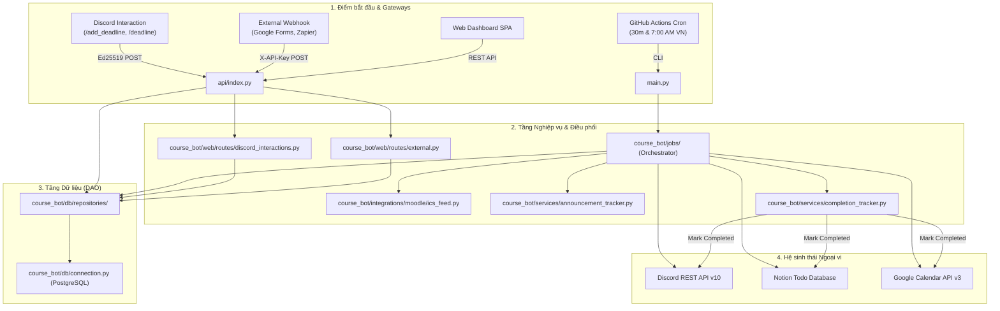

# REPOSITORY CONTEXT PACK (BẢN TỔNG HỢP TOÀN DIỆN)

> **Cập nhật 2026-10-16:** đường dẫn và cây thư mục trong tài liệu này đã được cập nhật theo cấu trúc sau đợt tái cấu trúc (`course_bot/`, `frontend/src/{app,features,shared}`). Xem `docs/architecture/refactoring-blueprint.md`.

> **Dự án:** Course FIT HCMUS Notification & Automation Platform (`course-fit-bot`)  
> **Người thực hiện:** Solution Architect  
> **Mục tiêu:** Cung cấp tài liệu ngữ cảnh kiến trúc chuẩn mực để nạp vào prompt cho Chuyên gia Prompt hoặc LLM Context Window.

---

## MỤC LỤC

1. [Cấu trúc thư mục cấp cao & Phân tầng kiến trúc](#1-cấu-trúc-thư-mục-cấp-cao--phân-tầng-kiến-trúc)
2. [Tech Stack & Môi trường Runtime](#2-tech-stack--môi-trường-runtime)
3. [Luồng dữ liệu tổng thể (End-to-End Data Flow)](#3-luồng-dữ-liệu-tổng-thể-end-to-end-data-flow)
4. [Bản đồ các Module trọng yếu (Core Modules Inventory)](#4-bản-đồ-các-module-trọng-yếu-core-modules-inventory)
5. [Cross-cutting Concerns & Điểm nóng kỹ thuật](#5-cross-cutting-concerns--điểm-nóng-kỹ-thuật)

---

## 1. Cấu trúc thư mục cấp cao & Phân tầng kiến trúc

### 1.1 Cây thư mục cấp cao (High-Level Directory Tree)
Độ sâu tối đa 3 cấp, đã loại trừ rác, cache và build artifacts (`node_modules`, `.git`, `venv`, `__pycache__`, `dist`, logs/locks):

```text
Notification Project/
├── .github/workflows/            # notify.yml (mỗi 30 phút), daily_summary.yml (06:55), ci.yml (test + build)
├── api/
│   └── index.py                  # Entry point Vercel duy nhất: re-export `handler` từ course_bot/web/router.py
├── course_bot/                   # Package backend (Python)
│   ├── cli.py                    # argparse: --summary, --progress, ... -> jobs/*
│   ├── core/                     # Tầng lá: config.py (env), logging_setup.py, time_utils.py (LOCAL_TZ, parse_due_time)
│   ├── domain/                   # Logic thuần, không I/O
│   │   ├── course_naming.py      # extract_subject, extract_display_name, slugify_channel_name
│   │   ├── semester.py           # get_current_semester, extract_semester_index
│   │   ├── reminders.py          # decide_reminder: NEW / 3_DAYS / 1_DAY
│   │   └── messages.py           # Mẫu tin nhắn deadline, build_event_url, sanitize_discord_text
│   ├── db/
│   │   ├── connection.py         # get_db, execute, fetch_one, fetch_all (psycopg2)
│   │   └── repositories/         # SQL theo bảng: courses, deadlines, moodle_content, notifications
│   ├── integrations/             # Client mỏng cho dịch vụ ngoài (không DB, không nghiệp vụ)
│   │   ├── discord/              # rest.py (REST v10, retry 429), signature.py (Ed25519)
│   │   ├── moodle/               # webservice.py (Moodle Web Services), ics_feed.py (tải + parse .ics)
│   │   ├── notion/client.py
│   │   └── google_calendar/client.py
│   ├── services/                 # Use-case dùng chung cho nhiều entry point
│   │   ├── channel_resolver.py   # Tìm / rename / tạo kênh môn trong category "kì N"
│   │   ├── manual_deadlines.py   # Chuẩn hoá + thêm deadline thủ công (Web, Discord, API bên thứ 3)
│   │   ├── completion_tracker.py # React ✅ -> đánh dấu hoàn thành
│   │   ├── deadline_crawler.py   # Thu thập assignment / quiz / calendar từ Moodle API, auto-complete
│   │   └── announcement_tracker.py # Phát hiện tài liệu / bài đăng diễn đàn mới
│   ├── jobs/                     # Runtime A (cron/CLI): mỗi chế độ của main.py một file
│   │   ├── notify.py             # (mặc định) quét deadline, gửi thông báo + nhắc nhở
│   │   ├── reports.py            # --summary, --progress
│   │   ├── announcements.py      # --announcements
│   │   ├── crawl_deadlines.py    # --crawl-deadlines
│   │   ├── sync_channels.py      # --sync-channels
│   │   ├── sync_external.py      # --sync-notion, --sync-gcal
│   │   └── dedup.py              # --dedup
│   └── web/                      # Runtime B (Vercel HTTP): không import jobs/, Notion, Google Calendar
│       ├── router.py             # BaseHTTPRequestHandler + điều hướng /api/*
│       ├── http_utils.py         # JSON, CORS, đọc body
│       └── routes/               # dashboard.py, discord_interactions.py (/interactions), external.py (/add_deadline)
├── frontend/                     # Web Dashboard (Vite + React + TypeScript + Tailwind)
│   └── src/
│       ├── app/                  # App.tsx, main.tsx, layout/ (Header, Sidebar, BottomNav), useDashboardData, useTheme
│       ├── features/             # announcements, courses, dashboard, deadlines, settings (view + hook dữ liệu)
│       ├── shared/               # ui/, api/client.ts, types/, utils/, hooks/
│       └── index.css
├── migrations/                   # SQL schema (001, 002, 004, 005; không có 003, xem NOTES.md)
├── scripts/                      # Công cụ chạy tay: python -m scripts.<nhóm>.<tên>
│   ├── ops/                      # register_commands, set_category, clean_bot_messages, rename_all_channels, ...
│   ├── dev/                      # run_server (API + dist local), start.ps1, check_url, dump_moodle_data, notion_helper
│   ├── debug/                    # Kiểm tra với token thật (gọi Discord / Moodle thật)
│   └── termux/setup_termux.sh    # Cài máy trạm Android (cron + 10 widget)
├── tests/                        # pytest: unit/ (core, domain, db, integrations, services, jobs, web) + smoke/bundle/import-direction
├── docs/                         # architecture/, guides/, planning/, design/, context-pack/
├── main.py                       # Entry point CLI (GitHub Actions, Termux): gọi course_bot.cli.main()
├── pyproject.toml / requirements.txt
├── vercel.json                   # Build frontend/, rewrite /api/* -> api/index.py
└── .vercelignore                 # Loại main.py, cli.py, jobs/, Notion, Google Calendar, scripts/, tests/, docs/ khỏi bundle
```

### 1.2 Phân tầng kiến trúc (Architectural Layers)
1. **Ingestion / Gateway Layer (`api/`, `main.py`):** Tiếp nhận HTTP Request từ Vercel Serverless, Webhooks và CLI Trigger từ GitHub Actions.
2. **Presentation Layer (`frontend/src/`):** React 18 SPA quản trị Dashboard, Kanban, danh sách hạn nộp.
3. **Application / Orchestration Layer (`course_bot/jobs/`, `course_bot/services/completion_tracker.py`):** Điều phối luồng thông báo, đối soát phản hồi hoàn thành.
4. **Domain Services Layer (`course_bot/services/announcement_tracker.py`, `course_bot/integrations/moodle/ics_feed.py`, `course_bot/web/routes/discord_interactions.py`):** Quy tắc nghiệp vụ parse ICS, sinh slug, bóc tách học kỳ.
5. **Infrastructure & Adapters Layer (`course_bot/integrations/discord/rest.py`, `course_bot/integrations/notion/client.py`, `course_bot/integrations/google_calendar/client.py`, `course_bot/integrations/moodle/webservice.py`):** Kết nối Discord REST API, Notion API, Google Calendar API và Moodle API.
6. **Data Access Layer (`course_bot/db/connection.py`, `course_bot/db/repositories/`):** Context manager psycopg2 và tập trung toàn bộ raw SQL.

---

## 2. Tech Stack & Môi trường Runtime

* **Backend / Automation:**
  * **Python >= 3.10** (Thực thi trên GitHub Actions runner `ubuntu-latest` và Vercel Python Serverless Runtime).
  * `psycopg2-binary`: Driver PostgreSQL với `RealDictCursor`.
  * `requests`: Client HTTP gọi REST API bên ngoài.
  * `pynacl`: Xác thực mật mã Ed25519 cho Discord Webhook.
  * `google-auth (>= 2.0.0)` & `google-api-python-client (>= 2.0.0)`: Google Calendar API v3 Service Account SDK.
  * `python-dotenv`: Đọc cấu hình môi trường phát triển.
* **Frontend Web Dashboard:**
  * **React 18.3.1**, **TypeScript 5.7.3**, **Vite 6.1.0**.
  * **Tailwind CSS 3.4.17**, `clsx` (2.1.1), `tailwind-merge` (2.6.0), `lucide-react` (0.475.0).
* **Database & Hosting:**
  * **PostgreSQL (Supabase)**.
  * **Vercel:** Hosting Frontend SPA và Python Serverless Functions.
  * **GitHub Actions:** Bộ thực thi Cron định kỳ (`*/30 * * * *` và `0 0 * * *`).

---

## 3. Luồng dữ liệu tổng thể (End-to-End Data Flow)



---

## 4. Bản đồ các Module trọng yếu (Core Modules Inventory)

| Tên File | Trách nhiệm chính | LOC | Mức độ phức tạp |
| :--- | :--- | :---: | :---: |
| [`course_bot/jobs/`](file:///e:/coder/OnlyC%28ode%29/Notification%20Project/course_bot/jobs/) | Điều phối luồng xử lý toàn cục: quét deadline, gửi thông báo theo cấp bậc, nhắc hạn 3 ngày/1 ngày, tổng kết hàng ngày, đồng bộ kênh Discord, đồng bộ Notion & Google Calendar. | 791 | **Cao** |
| [`course_bot/integrations/discord/rest.py`](file:///e:/coder/OnlyC%28ode%29/Notification%20Project/course_bot/integrations/discord/rest.py) | Client Discord REST API v10: tạo/đổi tên kênh, phân nhóm Category, gửi tin nhắn, reaction, Scheduled Events, retry Rate Limit (429), quét và dọn tin lặp. | 559 | **Cao** |
| [`course_bot/db/repositories/`](file:///e:/coder/OnlyC%28ode%29/Notification%20Project/course_bot/db/repositories/) | DAO tập trung toàn bộ raw SQL cho `courses`, `deadlines`, `course_modules`, `forum_discussions`, dashboard stats. | 501 | **Trung bình** |
| [`course_bot/services/announcement_tracker.py`](file:///e:/coder/OnlyC%28ode%29/Notification%20Project/course_bot/services/announcement_tracker.py) | Crawler nội dung Moodle: quét cây tài liệu, phát hiện slide, bài tập mới và bài đăng diễn đàn mới. | 335 | **Trung bình** |
| [`course_bot/integrations/google_calendar/client.py`](file:///e:/coder/OnlyC%28ode%29/Notification%20Project/course_bot/integrations/google_calendar/client.py) | Adapter tích hợp Google Calendar API v3 qua Service Account: chống trùng, đặt 3 mốc push notification, đổi màu xanh lá khi xong. | 345 | **Trung bình** |
| [`course_bot/integrations/notion/client.py`](file:///e:/coder/OnlyC%28ode%29/Notification%20Project/course_bot/integrations/notion/client.py) | Adapter tích hợp Notion REST API: tự động nhận diện schema database Notion, tạo todo card và đồng bộ tick hoàn thành. | 300 | **Trung bình** |
| [`course_bot/integrations/moodle/ics_feed.py`](file:///e:/coder/OnlyC%28ode%29/Notification%20Project/course_bot/integrations/moodle/ics_feed.py) | Parse iCalendar ICS, bóc tách môn, tính học kỳ, bỏ dấu tiếng Việt, sinh slug kênh Discord chuẩn. | 58 | **Trung bình** |
| [`api/index.py`](file:///e:/coder/OnlyC%28ode%29/Notification%20Project/api/index.py) | API Gateway Vercel: xử lý CORS, phân luồng GET/POST cho Dashboard, Discord Webhook và Third-party API. | 10 | **Trung bình** |
| [`course_bot/web/routes/discord_interactions.py`](file:///e:/coder/OnlyC%28ode%29/Notification%20Project/course_bot/web/routes/discord_interactions.py) | Xử lý Discord Interactions: xác thực chữ ký Ed25519 (PyNaCl), thực thi lệnh `/add_deadline` và `/deadline`. | 166 | **Trung bình** |
| [`course_bot/integrations/moodle/webservice.py`](file:///e:/coder/OnlyC%28ode%29/Notification%20Project/course_bot/integrations/moodle/webservice.py) | Client gọi API Moodle Web Services: ngụy trang User-Agent vượt WAF trường, lấy user/khóa học/nội dung/diễn đàn. | 209 | **Thấp** |
| [`course_bot/web/routes/external.py`](file:///e:/coder/OnlyC%28ode%29/Notification%20Project/course_bot/web/routes/external.py) | Xử lý webhook thêm deadline bên thứ 3: xác thực HMAC constant-time, parse JSON an toàn. | 98 | **Thấp** |
| [`course_bot/core/config.py`](file:///e:/coder/OnlyC%28ode%29/Notification%20Project/course_bot/core/config.py) | Validate biến môi trường, thiết lập logger và múi giờ Việt Nam (UTC+7). | 68 | **Thấp** |
| [`course_bot/db/connection.py`](file:///e:/coder/OnlyC%28ode%29/Notification%20Project/course_bot/db/connection.py) | Quản lý kết nối PostgreSQL bằng context manager `get_db()`. | 81 | **Thấp** |
| [`course_bot/services/completion_tracker.py`](file:///e:/coder/OnlyC%28ode%29/Notification%20Project/course_bot/services/completion_tracker.py) | Đối soát reaction `✅` từ người dùng trên Discord để kích hoạt chuỗi hoàn thành nhiệm vụ. | 43 | **Thấp** |
| [`course_bot/core/time_utils.py`](file:///e:/coder/OnlyC%28ode%29/Notification%20Project/course_bot/core/time_utils.py) | Tiện ích phân tích ngày tháng `parse_due_time` và gán timezone UTC+7 `ensure_tz`. | 77 | **Thấp** |
| [`frontend/src/app/App.tsx`](file:///e:/coder/OnlyC%28ode%29/Notification%20Project/frontend/src/app/App.tsx) | Layout + điều hướng tab; dữ liệu ở `app/useDashboardData.ts` và hook của từng feature. | 215 | **Trung bình** |

---

## 5. Cross-cutting Concerns & Điểm nóng kỹ thuật

### 5.1 Bảo mật & Xác thực
* **Discord Webhooks:** Xác thực chữ ký bất đối xứng **Ed25519** qua `pynacl.signing.VerifyKey`.
* **External Webhooks:** Xác thực khóa tĩnh qua `X-API-Key` với `hmac.compare_digest` chống Timing Attack.
* **Google Service Account:** Xác thực OAuth2 JWT qua Google Credentials.
* ⚠️ **Lỗ hổng cần lưu ý:** Các endpoint REST cho Web Dashboard trong `api/index.py` hiện tại mở hoàn toàn (`Access-Control-Allow-Origin: *`) và chưa có lớp xác thực người dùng.

### 5.2 Quản lý kết nối Database Serverless
* Dự án dùng `psycopg2` mở kết nối trực tiếp trong context manager `get_db()` và đóng ngay sau khi xử lý xong.
* **Điểm nóng:** Môi trường Serverless trên Vercel không có connection pool cục bộ, dễ gây cạn kiệt connection limit của Supabase. Khuyến nghị cấu hình `DATABASE_URL` dùng cổng Transaction Pooler `6543`.

### 5.3 Rà soát Nợ kỹ thuật
* **TODO / FIXME / HACK:** Không có bất kỳ thẻ nợ kỹ thuật nào trong code logic.
* **Lệnh `pass`:** Chỉ dùng an toàn khi bỏ qua import `python-dotenv` trên môi trường cloud.
* **Exception handling:** Cô lập lỗi ngoại vi an toàn (lỗi từ Google Calendar và Notion API chỉ log warning, không làm crash luồng bot chính).
